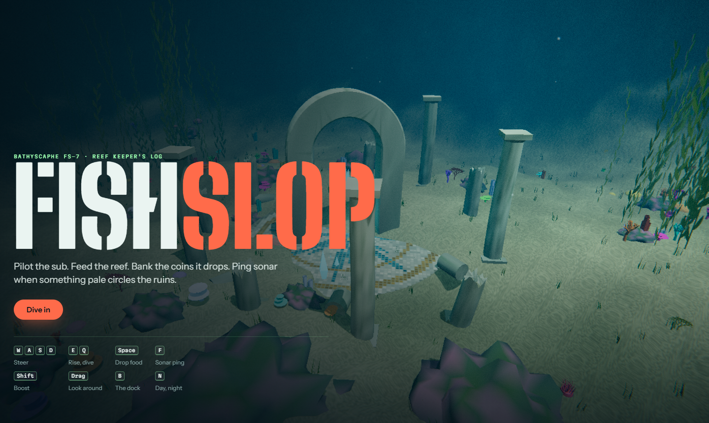
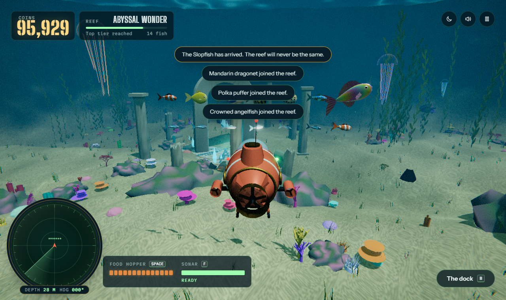
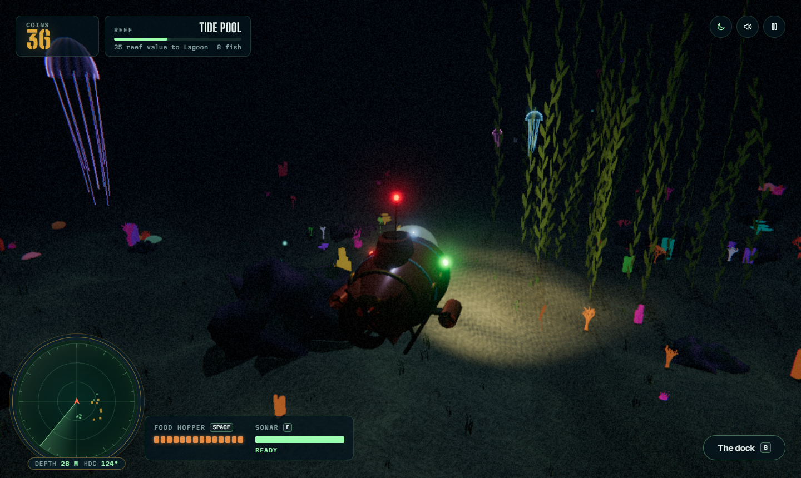
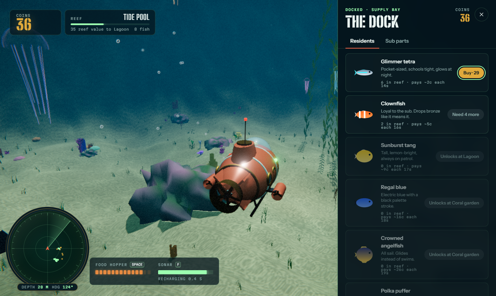

# Fishslop

A 3D underwater reef-keeping game that runs entirely in the browser. Pilot a bathyscaphe through a sunken ruin, feed the fish, bank the coins they drop, grow the reef, and ping sonar to catch the Veilfin, a pale fish nothing else can see.

**Play:** https://vasu-devs.github.io/FishSlop_Opus5.5/

It's an original take on the idea behind Theo's (t3.gg) one-shot "Fishslop" demo: sub, fish, feeding, sonar, 3D aquarium. The code, models, textures and sounds here are all new. Every asset is generated at runtime from code: the fish, sub, corals, ruins, textures and audio. No image, model or audio files ship with the game.






## How to play

| Keys | Action |
|---|---|
| `W` `A` `S` `D` | Steer, relative to the camera |
| `E` / `Q` | Rise / dive |
| `Space` (hold) | Drop food from the hopper |
| `F` | Sonar ping |
| `Shift` | Boost |
| Drag, or arrow keys | Look around. Mouse wheel zooms |
| `B` | Open the dock (shop) |
| `N` | Toggle day / night |
| `M` | Mute |
| `Esc` | Pause |

On touch screens you get a virtual stick plus Rise, Dive, Boost, Ping and Feed buttons.

**The loop:** hungry fish gather in front of the sub. Fed fish drop coins (bronze, silver, gold, pearl) that sink to the sand. Swim close and the magnet pulls them in. Every third meal, a fish grows, and bigger fish pay more. Starving fish go grey and stop paying, but they never die. Spend coins at the dock on new species and sub parts (propeller, food hopper, coin magnet, sonar array). Reef value unlocks tiers, from Tide pool up to Abyssal wonder, and each tier puts new species on sale. The goal is the legendary Slopfish.

**The Veilfin:** every minute or so, something invisible circles the basin. A sonar ping reveals it for a few seconds. Drop food in its path while it's revealed and it leaves a pearl worth 250.

Progress saves to `localStorage` every 5 seconds, on every purchase, and when you pause or leave.

## Run locally

Requires Node 20.19+ and a WebGL2 browser.

```bash
npm install
npm run dev          # http://localhost:5173
npm run build        # typecheck + production build into dist/
npm run preview      # serve dist/ on http://localhost:4173
```

URL options: `?quality=low` turns off shadows and post-processing. `?scale=0.5` caps render resolution.

## Architecture

```
src/
  core/      renderer-free game logic (runs in Node for tests)
    config.ts     every tunable number: world, sub, food, fish, coins, sonar, prices, tiers
    species.ts    species catalogue (shape, palette, behaviour, economy)
    sim.ts        Sim: fixed-step simulation, events, shop, save/load
    spatial.ts    uniform-grid spatial hash for flocking
    terrain.ts    seabed height field (precomputed grid, O(1) bilinear lookup)
    layout.ts     deterministic placement of rocks, corals, kelp, ruins + colliders
    economy.ts    prices, tiers, coin values
    save.ts       untrusted-JSON save parsing with clamping, guarded storage
  render/    Three.js only; reads Sim, never mutates it
    world.ts      renderer, adaptive resolution, orchestration
    environment.ts sky, sea surface (Snell's window), light shafts, marine snow, terrain
    reef.ts       procedural rocks, corals, kelp, seagrass, ruins, crystals (instanced)
    fishGeometry.ts / fishRenderer.ts  procedural fish + swim/pattern shader, one draw call per species
    submarine.ts  the bathyscaphe
    effects.ts    pellets, coins, sonar shells, bubbles, jellyfish
    post.ts       bloom + underwater lens pass
    shared.ts     global uniforms, caustics + sway shader patching
  audio/     WebAudio synthesis (ambience, motor, sfx)
  input/     keyboard, mouse, touch → SimInput
  ui/        HUD + sonar scope, dock, touch controls
  main.ts    game loop, modes (title / playing / paused), persistence
```

- **Simulation:** fixed 60 Hz steps with a frame-time clamp, so behaviour doesn't depend on frame rate. The `Sim` emits typed events (`coin`, `grow`, `sonar`, `veilfin-fed`…). Audio and UI consume those events and never poke at the simulation.
- **Complexity:** flocking uses a spatial hash, so neighbour queries are about O(N) rather than O(N²). Each fish rescans for food every 6th step, staggered. Terrain height lookups are O(1).
- **Rendering:** about 40 draw calls for the whole reef thanks to instancing. Caustics, plant sway and fish swimming all run in shaders patched onto Three's standard materials, so lighting, shadows and fog still work. Resolution adapts to hold frame rate.
- **Errors:** failures log a stable code (`E_SAVE_READ`, `E_AUDIO_INIT`, `E_WEBGL_UNAVAILABLE`, …) and never dump payloads. Missing WebGL shows a readable fix-it message.
- **Caching:** no runtime cache. Vite emits content-hashed assets, so a new deploy busts browser caches. The only persisted state is the save and settings in `localStorage`, and `parseSave` validates and clamps both on every load.

Design tokens and rules are in [DESIGN.md](DESIGN.md).

## Testing

```bash
npm test             # 36 Vitest unit tests: sim, economy, saves, terrain, layout, spatial hash
npm run test:e2e     # 8 Playwright end-to-end tests against the production build
```

The unit tests drive the renderer-free `Sim` directly. They cover movement and bounds, colliders, feeding and growth, coin drops, the magnet, starvation, shop rules, upgrades, tier progression, sonar, the Veilfin, and save round-trips, including hostile save data.

The e2e tests build the app, serve it, and play it in Chromium with real keyboard and pointer input. They cover the title render, steering, feeding, sonar, buying fish and parts, pause and resume, persistence across reloads, starting a new reef, the Veilfin reveal, and touch controls on a mobile viewport. They run at `?quality=low&scale=0.35`, so software GL in CI stays fast.

CI (`.github/workflows/deploy.yml`) runs typecheck, unit and e2e tests on every push and PR. On `main`, it then deploys `dist/` to GitHub Pages.
